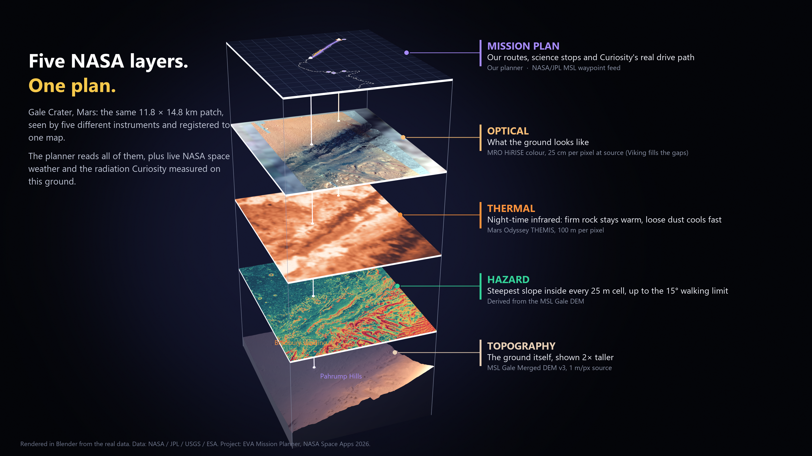

# EVA Mission Planner: Gale Crater

**Live app:** https://nasa-eva-planner.vercel.app · **NASA Space Apps 2026:** *Interplanetary Survival Guide: Martian Map*

**Pick a place in Gale Crater and get a Marswalk plan computed from real NASA terrain.** The planner finds a SAFE and a FAST route, and for each one works out the time outside, the oxygen left when you're back at the airlock, the steepest ground and the time you're back before sunset, with a GO / CAUTION / NO-GO verdict. A short briefing explains the recommended route in plain language. It is written in the browser from the computed numbers: **no AI runs in the app.**

**And the routes hold up against reality:** on the 5.9 km walk to the foot of Mount Sharp, our FAST route stays within 250 m of the path NASA's Curiosity drivers chose for 100 % of its length, and the SAFE route for 93.5 % ([docs/VALIDATION.md](docs/VALIDATION.md)).



## Three regions

Pick one on the landing page: **Gale Crater** (Curiosity), **Jezero Crater** (Perseverance: landing → Three Forks sample depot is GO on foot; Cheyava Falls, the possible biosignature, is NO-GO on foot and GO by rover) and **Hadriacus Palus** (a 2015 human Exploration Zone no rover has visited). Each is baked from a 1 m NASA/USGS elevation model by `python data/build_region.py <id>` (configs in `data/regions/`; Jezero's rover line: `node data/rover_traverse.mjs jezero M20`).

## Five NASA layers, one plan

The same 11.8 × 14.8 km patch of Gale Crater, seen by different instruments and registered to one map:

| Layer | NASA mission / instrument | Resolution | What the planner does with it |
|---|---|---|---|
| Topography | MSL Gale Merged DEM v3 (MRO HiRISE / CTX, Mars Express HRSC, MGS MOLA) | 1 m source → 25 m cells | Route search, 3D view, elevation layer |
| Slope hazard | Derived from the same DEM | steepest slope inside each 25 m cell | SAFE avoids ground above 10°, limit 15°; suit limit 20° |
| Optical | MRO HiRISE colour mosaic (Viking fills the gaps) | 25 cm source | The map you plan on, and the ground in the first-person ride |
| Thermal | Mars Odyssey THEMIS night infrared | 100 m | Thermal layer: firm rock stays warm at night, loose dust cools fast |
| Mission plan | Our routes + Curiosity's real drive path (NASA/JPL MSL feeds) | 1,270 rover stops in the box | Compare a plan with where NASA actually drove |

On top of those: 15 years of NASA-orbiter dust-storm records.

## What you can do in the app

- **Plan a walk.** Click a science site, a bookmark or any point on the map. Two route cards appear (SAFE, FAST), each with time outside, O₂ left, distance, steepest slope, return time and a verdict with its reason.
- **Read the briefing.** One paragraph on the recommended route and how the other one compares, built from the computed numbers.
- **Choose when to leave.** The *Leave at* slider moves the walk along Gale's daylight. A route that ends after sunset is flagged.
- **Switch the map.** 2D or 3D relief, and two layers: **Thermal** (THEMIS) and **Elevation** (colour-coded 1 m terrain). **Slope** is one click in the dock. The **Globe** button shows all of Mars from NASA Mars Trek. Hover the map for coordinates, elevation and a modelled ground temperature.
- **Run the mission simulator.** Five seeded simulations walk from Point 1 to Point 2, each with its own appetite for risk, hidden ground and weather, labelled **FASTEST**, **SAFEST** and **BALANCED** (plus two more). Each has a plain-language account, a step-by-step list of legs, and the assumptions behind it. **What if a dust storm hits?** forces a storm into every run. **+ Pit stop** adds a stop that every route passes through.
- **Go by rover.** *Rover assist* plans the same trip with an unpressurised rover. Glen Torridon is NO-GO on foot and GO by rover.
- **Carry science gear.** *Science gear carried* (None / 10 kg / 20 kg) re-prices every route and simulation: the extra load costs oxygen on every step.
- **Ride it.** *Simulate* plays the whole EVA on the map with a live oxygen gauge, or in **first person** over the real terrain. In first person the mission card starts as a small pill and opens when you click it.
- **Check the sources.** *Data & credits* lists every dataset, model and library with its link.

## Why Gale Crater

- **A human Exploration Zone candidate.** Gale was proposed at NASA's 2015 First Landing Site / Exploration Zone workshop for human missions.
- **Ground-truthed science.** Every site on the map is one Curiosity studied: an ancient freshwater lake (Yellowknife Bay), lake-bed layers at the foot of Mount Sharp (Pahrump Hills), a hematite ridge (Vera Rubin Ridge), and clays with organic molecules (Glen Torridon, Woodland Bay). Three of the five sit on Curiosity's real stops from NASA/JPL's waypoint feed.
- **The sharpest terrain on Mars.** USGS made a 1 m elevation model of this area for Curiosity's drivers, so a 12 × 15 km walking zone can be planned at 25 m resolution.

## What a plan looks like (real data)

Round trips from Bradbury Landing, Curiosity's touchdown site. Reproduce with `node planner/scripts/demo-numbers.mjs`.

| Target | One way | Best route | O₂ left at the airlock | Verdict |
|---|---|---|---|---|
| Yellowknife Bay | 0.4 km | 36 min | 93 % | GO |
| **Pahrump Hills** (foot of Mount Sharp) | 5.9 km | 4 h 01 min | 46 % | **GO** |
| Glen Torridon (clays + organics) | 9.4 km | 6 h 32 min | 4 % | **NO-GO on foot** |
| Glen Torridon, **rover assist** | 9.4 km | 4 h 04 min | 73 % | **GO** (setup panel → Mode → Rover assist) |

Carrying 20 kg of science gear turns the Pahrump walk from GO to CAUTION (29 % O₂): setup panel → Mode → **Science gear carried**. Every time above includes 20 min of work at the destination before heading back.

## How it works

```
NASA / USGS rasters ──► data pipeline ──► region files ──► planner (in the browser) ──► map + route cards
 1 m DEM · HiRISE ·       (Python)         elevation,        A* search per strategy         │
 THEMIS · MSL feeds                        slope, imagery,   + suit O₂ / time model         ▼
                                           sites, rover path                     briefing + simulator
```

1. **Data pipeline** (`data/build_region.py`, one JSON config per region) reads only the needed window of each NASA/USGS raster and bakes a 473 × 593 grid of 25 m cells: elevation, the steepest slope inside each cell (from a 12.5 m grid), HiRISE colour (Viking fills the gaps) and THEMIS night-time thermal imagery.
2. **Planner** (`planner/`, plain JavaScript in a Web Worker) runs A* on that grid, scored as an out-and-back walk:
   - **SAFE** minimises oxygen use, penalises every degree above 10° (between cells and inside them, limit 15°).
   - **FAST** minimises walking time (limit 20°).
   - **SCIENCE** also stops at the science sites on the way that cost the smallest detour. The planner computes and tests it, but the app shows SAFE and FAST only; stops on the way are added with **+ Add pit stop** in Quick targets.
   - Every route works 20 min at the destination (and at each pit stop) before heading back.
   - **Rover assist** (`params: { rover: true }`) plans for an unpressurised rover: 1.4 m/s, 20° limit, seated O₂ use.
   - Routes are drawn as a smoothed line that is never steeper than the computed path and stays within 62 m of it; the numbers stay on the computed path.
3. **Suit model:** walking speed vs slope (Tobler-style), metabolic power from the Pandolf load-carriage equation scaled to Mars gravity with a pressure-suit penalty, a 25 % O₂ reserve, an 8 h suit limit and a 20° walking limit. It comes out at 313–353 W, at the top of Apollo's measured 228–352 W range, which fits Mars gravity being ~2.3× the Moon's.
4. **Safety:** daylight vs Gale's sunset (Mars24).
5. **Recommendation** is a fixed rule: best verdict first (GO, then CAUTION, then NO-GO), then SAFE, then FAST.
6. **Mission briefing**, written in the browser from the computed numbers (no AI, no server call): the recommended route and how it compares with the alternative.
7. **Mission simulator** (`planner/src/candidates.js`): five seeded simulations from Point 1 to Point 2. Each seed has its own risk appetite (from pure speed to most cautious), its own hidden ground (soft sand vs packed soil, which a 25 m map can't see) and its own weather, so each finds and walks its own route. **Dust-storm chance is NASA-orbiter data:** the Mars Dust Activity Database (MGS MOC + MRO MARCI, Mars Years 24–32, 14,974 storms) gives how often a storm covered this area in each season. Seeds make every run replayable.
8. **Whole-planet view:** NASA Mars Trek's global mosaics (Viking colour, MOLA relief, THEMIS day infrared) are loaded only when you press **Globe**, so the planner stays light.

## Validation

We compared our routes with the path Curiosity actually drove (NASA/JPL waypoints), sampled every 10 m:

| Bradbury Landing → | Route | Within 100 m | Within 250 m | Max distance from Curiosity's path |
|---|---|---|---|---|
| Yellowknife Bay | all | 96.2 % | 100 % | 113 m |
| Pahrump Hills | FAST | 62.1 % | **100 %** | 204 m |
| Pahrump Hills | SAFE | 53.0 % | 93.5 % | 311 m |

Curiosity drove 8.4 km to Pahrump Hills against our 5.9 km, because it made science stops on the way and protected its wheels. Method, energy check, sensitivity and limits: [docs/VALIDATION.md](docs/VALIDATION.md). Reproduce: `node planner/scripts/validate-gale.mjs`.

## NASA data used

| What | Dataset | Mission / instrument | Resolution |
|---|---|---|---|
| Elevation + slope | MSL Gale Merged DEM v3 (USGS, Parker & Calef 2016) | MRO HiRISE / CTX, Mars Express HRSC, MGS MOLA | 1 m source → 25 m grid |
| Colour imagery | MSL Gale HiRISE colour mosaic (USGS) | MRO HiRISE | 25 cm source (74 % of the box) |
| Colour (gap fill) | Viking MDIM 2.1 colour mosaic | Viking Orbiter | ~232 m |
| Thermal layer | THEMIS Night IR controlled mosaic v2 (USGS) | Mars Odyssey THEMIS | 100 m |
| Rover path + site positions | MSL waypoints and traverse line (NASA/JPL MMGIS) | Curiosity | 1,270 stops in the box |
| Dust-storm chance | Mars Dust Activity Database (Battalio & Wang 2021) | MGS MOC + MRO MARCI | 14,974 storms, Mars Years 24–32 |
| Whole-planet layers | NASA Mars Trek mosaics | Viking, MGS MOLA, Mars Odyssey THEMIS | 100–463 m |
| Ground temperature (model) | REMS ground temperature at Gale (Martínez et al. 2017) | Curiosity REMS | daily range |

All sources with links: `web/lib/credits.ts` (also shown in the app under **Data & credits**) and [docs/DATASETS.md](docs/DATASETS.md). Challenge checklist, row by row: [docs/CHALLENGE.md](docs/CHALLENGE.md).

## Honest limits

- **Boulders aren't modelled.** 25 m cells see slopes, not individual rocks. The rocks in the first-person ride are decorative.
- **No mineral (CRISM) layer.** Mineral facts in the site descriptions come from published Curiosity results.
- **One region baked.** The pipeline is region-driven, but only Gale has been run.
- **Two site positions are approximate** (Glen Torridon, Woodland Bay). The other three are Curiosity's real stops.
- **The suit model is a planning estimate**, not a validated Mars-suit model.
- **One astronaut.** No two-person EVA logic yet.
- **The hover temperature is a model** (Curiosity's measured daily range by local solar time), not a measurement of that spot.
- **Simulator event sizes are assumptions.** Storm *chance* comes from MDAD, but storm opacity (τ), the hidden-ground range and pace/effort spread are our estimates, listed in the app (Simulator → Assumptions). Storms are far bigger than the map, so routes can't go around them: the crew keeps going or turns back.

## Credits

- Data: NASA, JPL-Caltech, USGS Astrogeology, ESA/DLR/FU Berlin (HRSC), University of Arizona (HiRISE), Arizona State University (THEMIS), NASA GISS (Mars24), NASA Mars Trek (JPL Solar System Treks), Battalio & Wang (MDAD, CC0).
- Map: MapLibre GL JS (BSD-3). First-person view: three.js (MIT). App: Next.js. The layered-data picture was rendered in Blender from the same data files the app uses.

## AI use

Built with Claude Code (Anthropic) as a coding assistant under our direction: it wrote much of the code and documentation to our specifications. **The running app uses no AI and no API keys:** routes, numbers, verdicts and the briefing text are all computed by ordinary code. No AI-generated images, video or audio. Details: [docs/AI-USE.md](docs/AI-USE.md).

## Team

- **Moss** (MossimoB): product, frontend, UI/UX
- **Gianluca** (Gianluca-Vanier): data, routing, simulator

## Run it locally

```
# web app (Node 20+)
cd web && npm install && npm run build && npx next start -p 3123     # → http://localhost:3123

# planner tests (no dependencies) and the numbers in this README
cd planner && npm test
node planner/scripts/validate-gale.mjs        # from the repo root
node planner/scripts/demo-numbers.mjs

# re-bake the Gale data from NASA/USGS (needs internet; ~15 min)
pip install rasterio numpy pillow scipy
python data/build_region.py gale
```

Nothing to configure: the app needs no accounts and no secrets.
